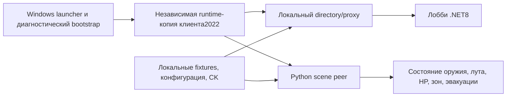

# Как устроен наш запуск

Код и конфигурации находятся в ring-of-elysium-local: `tools/windows_launch.py` готовит независимый runtime и стенд; `tools/bootstrap.ps1` устанавливает зависимости; `server/lobby/` собирает адаптацию лобби из MIT-кода; `server/directory/game_endpoint_probe_2022.py` связывает сцену и обработчики. Остальные `*_probe_2022.py` и state-модули ведут отдельные механики. `config/` содержит диагностические профили, wire fixtures и положения объектов. Все сервисы штатного одиночного запуска — localhost.

Это не запуск извлечённого серверного EXE. Диагностический bootstrap клиента и внешняя упрощённая симуляция дают игровую сцену. Исходные серверные RNG, AI, авторитетный расчёт попаданий и полная сессия нескольких Windows-клиентов не восстановлены.

В Proton-опытах использовались отдельные net namespace, Wine-prefix/X11, аппаратные точки GDB, адресное чтение кода и публичных полей; запуски завершались с проверкой хешей/очисткой. Контейнер не обязателен. Точная Linux/GPU-среда зависит от стенда; историческая [среда](docs/JUPYTER-ENVIRONMENT.md) не устанавливается автоматически этим репозиторием.

Версии:2022 — наиболее развитая игровая реконструкция; V99 — отдельная диагностическая ветка с подтверждённым прежним Windows→Linux LAN; Steam2018 — статические зацепки host без доказанного полноценного native-host. Не переносите адреса и bootstrap между ними.
