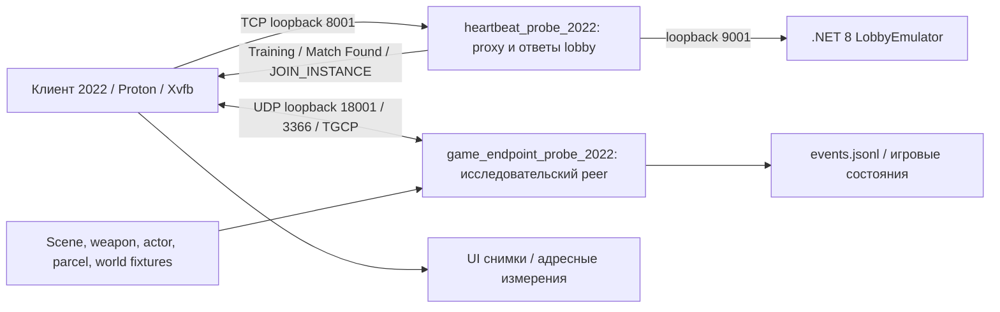
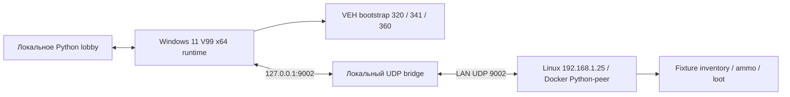

Актуализация11.10.2026: [проверка двух клиентов и общего наземного лута](SHARED-GROUND-20261011.md). NET09 ready40; общего HP/clock/vehicles, leave/epoch и выдачи существующего динамического лута при позднем входе ещё нет. Windows launcher одиночный.

**Актуально08.10, ночь:** [два слота, timed reload и пассивная мишень](RECOVERY-20261008-NIGHT.md). Следующий №22/INV02 — pages/consumables; две пушки уже работают. Новый Windows-повтор и dual-gun reconnect остаются открытыми. Учебная защита50% не является исходной формулой ROE.

# Архитектура исследовательских запусков

Это архитектура нашего стенда. Исходное устройство исторического backend полностью не восстановлено. «Внешний сервер» здесь означает собственный Python-peer, а «native adapter» — диагностический клиентский bootstrap; ни один не доказывает найденный встроенный host.

## 2022: текущая зимняя сцена под Proton, без Docker

Клиент и собственные listeners находятся **в одном отдельном `unshare --net` namespace с одним lo**. Фактические порты сверяются с `run.sh`, `listeners.txt`, настройками proxy/endpoint. Лобби исходного стороннего emulator отвечает начальным набором кадров; наш proxy добавляет heartbeat/team/match/training и route/join-переход. Endpoint выполняет handshake/ident/grant/auth тестового игрового канала и передаёт игровые сообщения. Для lobby нужен отдельно подготовленный локальный session-key; секрет не включён в контекст.

`run_winter_demo.py` → `run_trial.py` → собственный `run.sh`. Proton запускает независимый `runtime/client`, использует prefix `runtime/proton-2022`. AutoUI проходит Training/выбор точки/начальные действия. `ui.py` делает адресные ручные действия и снимки. Таймер и disk guard ограничивают опыт; trap останавливает только собственные процессы/prefix.

Состояния оружия, цели/бота, контейнера, транспортных мест и зон ведёт внешний endpoint. Геометрия/физика/рендер клиента продолжают работать локально. Серверного raycast, полноценной физики и исходного AI нет. Actor/loot/vehicle fixtures — малые wire-шаблоны выбранного билда, не произвольные native structs.

Новый слой07.10: TableBin.sfc loot/control → export_loot_tables_2022 (H1 явно гипотетическая) → make_demo (Citori/три ручные точки); machine1 → make_timed_demo → scene/world с исходными либо масштабированными часами. VehicleState связывает rope/heli, принимает настоящую посадку и отправляет6580/106E/D62/6589. Газетное имя native, Stats архивные. После явного5001/повторного synthetic AUTH предусмотрен ограниченный перенос игровых объектов и дедлайна на новый UDP/TGCP transport, без переноса ключей/счётчиков; динамический повтор ещё требуется. Оригинальный GenericStartLoot/выбор точек/квоты не найдены.

## V99: от локальной очереди к настоящему UDP

Самый ранний V99 пресет через native-очередь не доказывал сеть. Поздние повторения 17/19 `hosting-route-20261006` доказали путь EXE LWIP → UDP3366 → Python peer → клиент. Linux/Proton использовал аппаратное наблюдение/GDB для bootstrap. Перенос на Windows реализован в `roe-server/tools/windows`: Python launcher, локальное lobby, UDP bridge, собственный VEH и временные поля клиента. Bridge объясняет лог `127.0.0.1:9002`, даже когда удалённый сервер — 192.168.1.25.

Docker здесь содержит только Python сервер; клиента, GPU, Proton и .NET в нём нет. ПК 192.168.1.121; сервер фильтрует фактический IP источника. Это адреса конкретного стенда, не универсальные настройки. Windows-перенос не доказывает штатный login или устранение bootstrap.

## Steam2018 и ранний 2018

Steam: SLauncher → Steam API/tss SDK → Europa_ClientBase → EXE. Proton newWoW64 прошёл одну инфраструктурную x86 ошибку, но остановился до сцены на Warning(0,404,449). Диагностическая модель пяти Steam imports — ограниченная модель, не настоящая Steam авторизация. Native InitServerModule/Generic* backend не загружен и не исполнялся доказанно.

Ранний 2018 преимущественно статически инвентаризирован/распакован/индексирован. Для него нет доказанной архитектуры рабочего игрового сервера. Не переносить схемы V99/2022 как результат исполнения этого клиента.

## 08.10, вечер: граница игрового состояния

Один WeaponState теперь поддерживает один занятый weapon slot сCitori илиM4, два независимыхammo типа30004/30001 вbag slots1/2, общийвес и equipment_durability. Catalog использует нашAOI, ограниченные batches иавторитетные picked/remaining; handoff переносит тежеигровыеобъекты. Serial32 guard только текущего транспорта. Native snapshot издвухgun records принимается, но server49e2/discardslot2 ещёнеобслуживаются. ДляINV02 нужны registry guninstances иsync обоихмагазинов после5fb, анеещёодинстатичныйsnapshot. ИсходныйGenericStartLootprovider отсутствует; H1 остаётся гипотезой. [Первичные отчёты](RECOVERY-20261008-EVENING.md).
